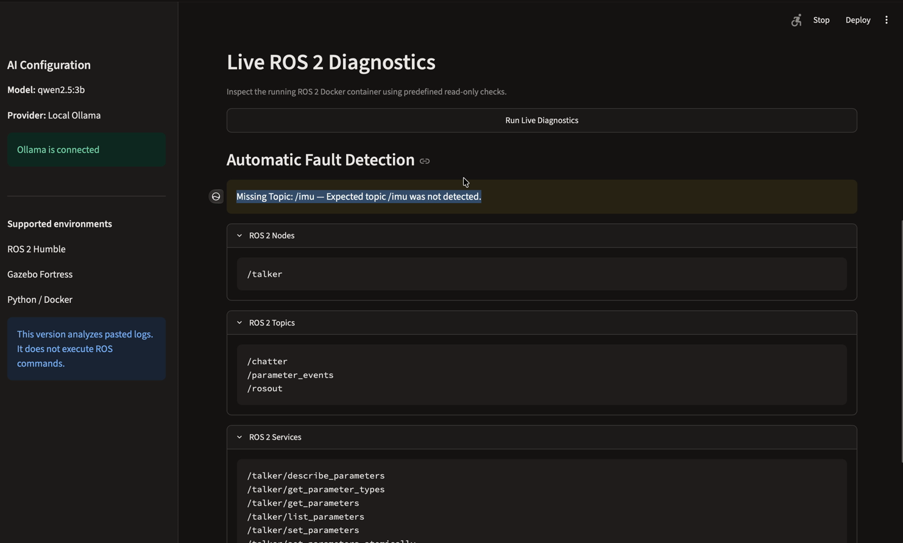
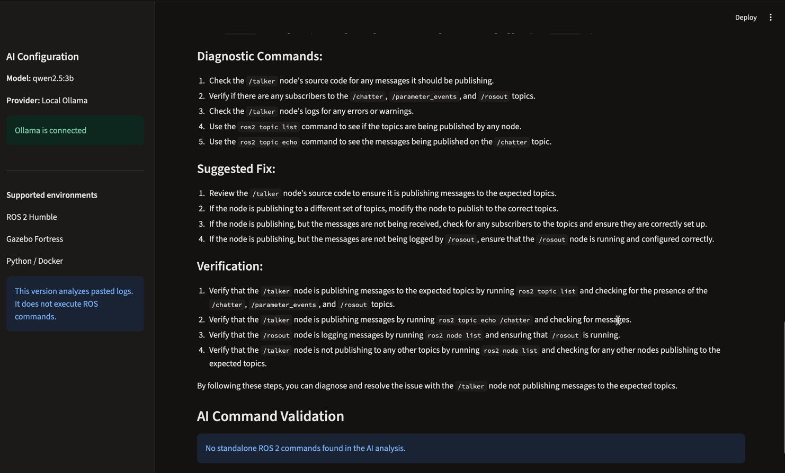

# 🤖 RoboFix AI

**Local AI-Powered ROS 2 Troubleshooting Assistant**  
Built by **Abhilash B** for **Homingo Hack Days 2026**.

[](https://www.python.org/) [](https://docs.ros.org/en/humble/) [](https://streamlit.io/) [](https://ollama.com/)

## Overview

RoboFix AI is an **educational ROS 2 diagnostics prototype**. It collects read-only information from a running ROS 2 environment, compares observed nodes and topics with expected resources, and asks a **locally running Ollama model** to explain the results. It also offers a preliminary check of ROS 2 diagnostic command forms and downloadable Markdown reports.

The aim is to make the first stage of ROS troubleshooting easier to understand — **without automatically executing LLM-generated commands or claiming to repair robots**.

## Demo

The recorded demonstration shows the Streamlit interface, local Ollama connection, live node/topic/service discovery, a missing-resource warning, AI analysis, command-validation UI, and the GitHub repository.

**Video:** Add the uploaded demonstration link here after publishing it (LinkedIn, YouTube, or the hackathon-approved host).

### Live ROS 2 diagnostics



### AI analysis and command-validation interface



## Features

- **Log analysis:** Paste a ROS 2 error log or upload `.log` / `.txt` text to request an AI-assisted explanation.
- **Read-only live diagnostics:** Collect ROS 2 nodes, topics, and services from a Docker container.
- **Expected-resource checks:** Flag missing expected node or topic names.
- **Local AI:** Use Ollama with `qwen2.5:3b`; an internet-hosted model is not required for local inference.
- **Preliminary command validation:** Identify recognized basic ROS 2 diagnostic command forms in extracted suggestions, and flag unsupported forms for manual review.
- **Markdown reports:** Download the diagnostic results.

## What the demonstration verifies

| Check | Observed result |
| --- | --- |
| Node discovery | `/talker` appears |
| Topic discovery | `/chatter`, `/parameter_events`, `/rosout` appear |
| Missing-resource detection | Configured `/imu` expectation is not met; warning displayed |
| AI analysis | Local Ollama analysis is displayed |
| Command-validation UI | Appears; the recorded response returned **no standalone ROS 2 commands found** |
| Public project | Source code and README are visible on GitHub |

**Note:** The missing `/imu` check is **deliberately configured for demonstration**, not evidence of a broken IMU sensor. The presence of a topic alone is not proof of live message delivery.

## Tech stack

| Layer | Technology |
| --- | --- |
| Dashboard | Streamlit |
| Language | Python |
| ROS diagnostics | ROS 2 Humble |
| Runtime | Docker |
| Local LLM | Ollama — Qwen 2.5 3B |
| Reports | Markdown |

## Installation

Prerequisites: **Python 3**, **Docker Desktop**, a running ROS 2 Humble container compatible with the configured checks, and **Ollama** installed separately.

```bash
git clone https://github.com/abhi1228-DAM/robofix-ai.git
cd robofix-ai
python3 -m venv .venv
source .venv/bin/activate
python3 -m pip install -r requirements.txt
```

Pull the local model:

```bash
ollama pull qwen2.5:3b
```

Make sure the Ollama service is running on `127.0.0.1:11434`.

**Live Docker diagnostics:** The current implementation targets a container named `autofleet-desktop`, with ROS 2 under `/opt/ros/humble/` and a container user called `ubuntu`. Modify `live_diagnostics.py` if your environment uses a different container or ROS installation.

Run the application:

```bash
.venv/bin/python -m streamlit run app.py --server.address 127.0.0.1 --server.port 8765
```

Open **http://127.0.0.1:8765/** in your browser.

## Repository structure

```text
app.py                 # Streamlit interface and Ollama integration
live_diagnostics.py    # Read-only ROS 2 diagnostics through Docker
fault_detector.py      # Expected node/topic comparisons
command_validator.py   # Basic ROS 2 command-form checks
requirements.txt       # Python dependencies
README.md              # Project documentation
```

## Limitations and responsible use

- **AI explanations can be wrong.** Compare them with observed command outputs.
- The command validator is **preliminary**: it is neither a complete parser nor a security boundary, and its output must not be treated as permission to execute a command.
- The current command extractor may miss suggestions embedded in numbered lists or code blocks; in the recorded demonstration it finds no standalone commands.
- A missing node or topic can reflect an environment/configuration issue rather than a robot fault.
- Live diagnostics depend on the configured Docker environment; the app is **not** a general-purpose ROS installer or autonomous robot repair agent.

## Roadmap

- Select expected nodes and topics from the dashboard
- Improve ROS command extraction and argument validation
- Add reproducible diagnostic test scenarios and accuracy metrics
- Support additional containers and ROS 2 distributions

## Author

**Abhilash B**  
GitHub: [@abhi1228-DAM](https://github.com/abhi1228-DAM)  
LinkedIn: [abhi1228-dam](https://www.linkedin.com/in/abhi1228-dam/)

Built for **Homingo Hack Days 2026**.
